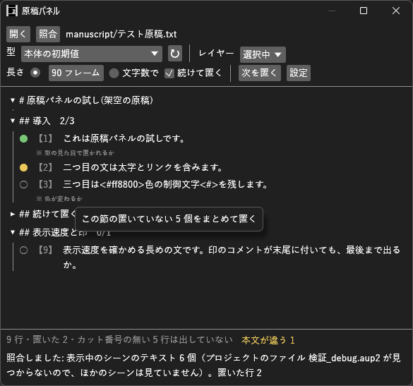

# ManuscriptPanel_H マニュアル

**ManuscriptPanel_H（原稿パネル）** は、Markdown で書いた原稿を行ごとに一覧にし、**クリックした行を、決めた見た目のテキストオブジェクトとしてカーソル位置に置く**プラグイン（Rust 製 `.aux2`）です。
「原稿はあるが、尺（表示時間）はまだ決まっていない」段階で、原稿の文を打ち直さずにテロップを置いていくのに使います。置いた行には印が付くので、どこまで置いたかが原稿の側で分かります。

- **バージョン:** 0.2.1（2026-10-10: 画面メモの頭の記号が □ になっていたのを直した。照合でプロジェクトのファイルが見つからないときの知らせを分かりやすくした。開いても出てこなかった編集メニュー・レイヤーの右クリックの「原稿パネルを開く」を外した。表示メニューから開きます）
- **作者:** by HexBrowns
- **必要環境:** AviUtl2 **2.1.11** 以上

**原稿のファイルは読むだけです。** 書き換えません。タイムラインに書き込むのは、行をクリックしたとき・ボタンを押したときだけです（1 回のクリックが、本体の Ctrl+Z 1 回分です）。

---

## 開き方

- **表示** メニュー → **原稿パネル**（ウィンドウ配置パネルからも選択可）

表示リストに出ない場合は AviUtl2 を再起動してください。

## 導入

1. [Releases](https://github.com/HexBrowns/ManuscriptPanel_H/releases) から `HexBrowns.ManuscriptPanel_H-v0.2.1.au2pkg.zip` をダウンロードし、AviUtl2 のプレビューへドラッグ&ドロップする
   （手で置くなら、中の `Plugin` フォルダをデータフォルダ `C:\ProgramData\aviutl2` へコピーする）
2. AviUtl2 を再起動する

設定は `Plugin/ManuscriptPanel_H/設定.json` に保存されます。

---

## 使い方

1. **開く** で原稿（`.md`）を選ぶ（原稿のファイルをパネルへドラッグしても開けます）
2. **型** で、置くテロップの見た目を選ぶ（下の「型」）
3. タイムラインで、置きたいレイヤーとフレームにカーソルを合わせる
4. 一覧の行をクリックする → その文の入ったテロップが置かれる

**続けて置く** がオンなら、続けて次の行をクリックすると、直前のテロップのすぐ後ろに並びます。**次を置く** を押すと、最後に置いた行の次の、まだ置いていない行を置きます。

### 一覧

- 見出し（`#`〜`######`）ごとに折りたためます。見出しの横の `3/12` は、その節で置いた行の数 / 行の数です
- 行頭の **【数字】** をカット番号として左に出します。**カット番号で始まらない行は、既定では出しません**（表記ルールや尺の見積もりの表などを除くため。設定で出せます）
- 行頭が **▸** の行は、直前の行の**画面メモ**として小さく出します（テロップにはしません）
- 行にマウスを乗せると、原稿の何行目か・置いた場所（シーン・レイヤー・フレーム）が出ます
- 行を右クリックすると **この行を置く** / **置いたテロップにフォーカスを移す** / **テロップを原稿の文に直す**（本文が違うとき）が出ます

| 左の印 | 意味 |
|---|---|
| ○ | まだ置いていない |
| ● 緑 | 置いた。クリックすると、置いたテロップを選んだ状態にします（表示中のシーンにあるとき） |
| ● 黄 | 置いたが、テロップの本文が今の原稿と違う（原稿だけ、またはテロップだけを直した） |

### 置く本文

原稿の Markdown の記法は外して置きます。

| 原稿 | 置く本文 |
|---|---|
| `**太字**` `*斜体*` `~~消し~~` `==強調==` `` `コード` `` | 記号を外した文字 |
| `[文字](URL)` | 文字 |
| `[[ノート\|表示名]]` / `[[ノート]]` | 表示名 / ノートの名前 |
| 行頭の `- ` `1. ` `> ` `- [ ] ` | 外す（`・` は本文として残す） |
| 画像・埋め込み・脚注 | 外す |
| ` ` | 改行 |
| **`<$強調>` `<#ff8800>` などの AviUtl2 の制御文字** | **そのまま残す**（原稿に書けば、そのまま効きます） |

一覧に出さないもの: 先頭の `---` で囲んだ前置き、`<!-- -->` と `%% %%` のコメント、コードブロック、水平線、表の区切り行、空行。

### 型

テロップの見た目は、**`Alias` フォルダのオブジェクトのエイリアス（`.object`）** で決めます。
フォントや色・縁取りを決めたテキストオブジェクトを、オブジェクト設定などからエイリアスとして保存しておくと（保存先は `C:\ProgramData\aviutl2\Alias`）、**型** に出ます（`Alias` フォルダの一つ下のフォルダも探します）。追加したら **↻** で読み直してください。

- 出るのは、**テキストオブジェクト 1 個**のエイリアスだけです（複数のオブジェクトをまとめたものや、テキストでないものは出ません）
- 型の本文は、原稿の文に置き換わります。型に付けたフィルタ効果はそのまま付きます
- **本体の初期値** を選ぶと、本体の初期値のテキストで置きます

### 置いた印と照合

置くとき、本文の末尾に **`<//原稿:ファイル名:番号//>`** を付けます。表示されないコメントで、見た目・表示速度には影響しません。
これがあるので、原稿を書き直した後や、別のパソコンでプロジェクトを開いた後でも、どの行を置いたかが分かります。

**照合** を押すと、プロジェクトのテキストを読んで印を付け直します。

- 表示中のシーンは今の状態を、ほかのシーンは**保存済みのプロジェクトファイル**を読みます（未保存の変更は、表示中のシーン以外は入りません）
- 印のあるテロップは印で、印の無いテロップは本文が同じかどうかで当てます。別の原稿の印が付いたテロップは当てません
- 手で消したテロップの印は、照合で外れます

**原稿をエディタ（Obsidian など）で保存すると、一覧を自動で読み直します。** 置いた印はそのまま残ります。
開いた原稿はプロジェクトの中に覚えるので、プロジェクトを保存して開き直すと、同じ原稿が開きます。

### 見出しを置く・節をまとめて置く

見出しを右クリックすると、次の操作が出ます。

| 操作 | 中身 |
|---|---|
| **見出しを置く（型: …）** | 見出しの文をテロップとして置く。設定の **見出しの型** で、その深さ（`#` の数）の型を決めたときだけ出ます |
| **この節の置いていない N 個をまとめて置く** | 節のまだ置いていない行を、カーソル位置から並べて置く（見出しの型を決めていれば、見出しも先頭に入ります）。間は設定の **まとめて置くときの間隔** だけ空けます。Ctrl+Z 1 回でまとめて戻ります |
| **この節の本文が違う N 行を原稿の文に直す** | 下の「本文が違う行」を、節の分だけ直す |

見出しの型を決めた見出しは、頭に ○（置いていない）/ ●（置いた）/ △（本文が違う）が付きます。

### 本文が違う行

原稿を直した後や、テロップの本文を手で直した後は、その行が黄色の ● になり、下の欄に **本文が違う N** が出ます。

1. **本文が違う N** を押す → 本文が違う行だけが出て、行の下にテロップの今の本文が出ます
2. **すべて原稿の文に直す** を押す → 表示中のシーンのテロップを、原稿の文で置き換えます（Ctrl+Z 1 回で戻ります）

1 行だけ直すときは、行を右クリック → **テロップを原稿の文に直す**。

- 直すのは、印の付いたテロップのうち、**表示中のシーン**にあるものだけです。ほかのシーンのものは、そのシーンを表示して **照合** してから直してください
- テロップの本文をまるごと置き換えるので、テロップの側で足した制御文字も消えます
- 照合の後にテロップを書き換えていたものは直しません（照合し直してください）

---

## 上の欄

| 欄 | 中身 |
|---|---|
| **開く** | 原稿を選ぶ |
| **照合** | プロジェクトのテキストを読んで、置いた行の印を付け直す |
| **型** | テロップの見た目（上の「型」）。**↻** で一覧を読み直す |
| **レイヤー** | **選択中**（タイムラインで選んでいるレイヤー）か、**固定**（番号を指定） |
| **長さ** | **フレーム数**（初期値 90 = 3 秒）か、**文字数で**（下の設定の式で決める） |
| **続けて置く** | オン（初期値）のとき、直前に置いたテロップの終わりの次のフレームに置く。カーソルを動かしたら、カーソルの位置に置く |
| **次を置く** | 最後に置いた行の次の、まだ置いていない行を置く |
| **設定** | 下の設定を開く |

置く場所に別のオブジェクトがあるときは、何も置かずに知らせます。

## 設定

| 項目 | 初期値 | 説明 |
|---|---|---|
| 1 テロップの単位 | 1 行 | **空行で区切った段落** にすると、空行までの行をまとめて 1 つのテロップにします（中の改行は保ちます） |
| カット番号のパターン | `^【(\d+)】` | 正規表現。1 番目の括弧が番号になります（括弧が無ければ当たった全体）。当たった部分は本文から外します。空にするとカット番号を使わず、すべての行を出します。**既定** で初期値に戻します |
| カット番号の無い行も出す | オフ | オンにすると、カット番号で始まらない行も一覧に出します |
| 画面メモの行頭 | `▸` | この文字で始まる行は、直前の行のメモにします。空なら使いません |
| メモを出す | オン | 画面メモを一覧に出す |
| 置いた行を隠す | オフ | 置いた行を一覧から隠す |
| 置く操作 | クリック | **ダブルクリック** にすると、うっかりクリックで置かなくなります |
| 印 | オン | 本文の末尾に印を付ける。オフにすると、照合は本文の一致だけで行います（原稿を直すと当たらなくなります） |
| まとめて置くときの間隔 | 0 フレーム | 「まとめて置く」で、テロップの間に空けるフレーム数 |
| 見出しの型 | すべて「置かない」 | `#`〜`######` の深さごとに、見出しを置くときの型（**置かない** / **本体の初期値** / Alias の型） |
| 文字数で決める長さ | 0.25 秒/字 + 0.5 秒、最短 25 フレーム | **長さ** を **文字数で** にしたときの式。制御文字と空白は数えません。初期値は、読む速さの上限 1 秒 4 文字・最短の表示 5/6 秒（字幕の目安） |

---

## 注意

- カット番号は、**行の頭に書いたもの**だけを数えます。字下げした行・リスト（`- `）・太字の中の `【22】` は数えません（原稿の中で別のカットを指しているだけのことが多いため）
- 印の **ファイル名** は原稿のファイル名（拡張子なし）です。原稿の名前を変えると、それまでに置いた印では当たらなくなります（本文が同じなら本文で当たります）
- 照合で読むのは、本体のテキストオブジェクトの本文だけです
